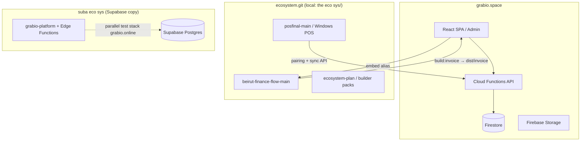

# Architecture — Overview

**Last updated:** 2026-09-15

## System diagram (current state)

## Per-repo summary

| Repo | [[Architecture/grabio.space|grabio.space]] | [[Architecture/ecosystem.git|ecosystem.git]] | [[Architecture/suba-eco-sys|suba eco sys]] |
|------|-------------|----------------|--------------|
| **Purpose** | Production platform (hosting, rules, API, admin) | Module source trees (finance, POS, plans) | Firebase→Supabase experiment |
| **Deploy target** | Firebase prod | Build artifacts consumed by main app; POS installer to Storage | grabio.online test only |
| **In grabio.space git?** | Yes (this repo) | **No** — gitignored; clone separately | **No** — separate nested repo |
| **Status** | PR #1 open (`feat/ecosystem-modular-local`) | `feat/ecosystem-modular-local` @ `baeb01b` has full eco tree | Schema migrated; R2 keys pending |

## Integration touchpoints

See [[Architecture/Integration-Map]].

## Package and workflow map

See [[Architecture/Packages-Workflows-Modules]] for the canonical mapping between client-facing verticals, starting packages, runtime workflows, default modules, tenant settings, and setup UI requirements.

## Fine-dining platform map

See [[Architecture/Fine-Dining-Platform-Map]] for the 2026-09-15 product pivot. Grabio's active product center is now fine-dining restaurant daily operations plus CRM. Accounting and inventory are optional maturity modules. Builder, template, SEO, and content stay connected inside Grabio as gated high-end client modules, not a separate platform.

## Developer landing map

See [[Architecture/Developer-Landing-Map]] before starting a new engineering session. It maps the main platform, apps, vendor finance, POS/ecosystem copies, client data, reporting evidence, and current no-risk status.

## Workspace organization

See [[Architecture/Workspace-Organization-Policy]] before moving, quarantining, archiving, or deleting workspace files. Inventory and approval are required before moves; 40-day quarantine means review eligibility, not automatic deletion.

## Setup surface separation

See [[Architecture/Setup-Surface-Separation]] before changing Store Profile, Invoice Document setup, or Website Template setup. Store profile, invoice document branding/numbering, and website theme ownership must stay clear.

## Role, permission, and environment policy

See [[Architecture/Role-Permission-Environment-Policy]] before changing builder access, accounting access, sub-account roles, route guards, sensitive-field visibility, mobile role behavior, POS role behavior, or demo/staging/production environment rules.

## Resolver contracts

See [[Architecture/Resolver-Contracts]] before implementing shared settings, role, module, or setup-progress resolver code.

## Tenant settings and capabilities

Grabio is a configurable multi-tenant platform. Client-specific behavior should not live as hidden code branches in web, POS, mobile apps, Cloud Functions, or Firestore rules.

Target model:

- `storeProfiles/{storeId}` and store-scoped settings are the source of truth for tenant behavior.
- Use typed groups such as `orderSettings`, `paymentSettings`, `reservationSettings`, `roleSettings`, `inventorySettings`, and `financeDocumentSettings`.
- Package gates decide whether a feature is available; tenant settings decide whether it is enabled and how it behaves.
- Defaults must be explicit so existing stores keep stable behavior after new options are introduced.
- Web admin, public marketplace, mobile apps, POS, and Functions must resolve the same effective setting for the same store.

Before implementation, classify every client request as global platform fix, tenant option, account data setup, or temporary exception. Reservations, advance restaurant orders, custom order statuses, team/customer status labels, enabled payment methods, and sub-account roles are tenant options unless proven global.

## UI-first setup loop

Store setup and data seeding must become product flows, not invisible backend-only work. Scripts and AI agents may accelerate setup, but the final system must let the store user see, review, correct, and continue the setup from the UI.

Required setup flow:

1. Admin UI explains required setup data and provides templates where useful.
2. User uploads or enters structured data such as products, recipes, costs, sale prices, raw materials, payment methods, roles, or order workflows.
3. Setup agent/import service validates, normalizes, and previews the result before writing store data.
4. User approves or corrects the preview.
5. Saved setup appears immediately in the relevant admin screens and consuming apps.
6. Any script-created data must have an equivalent UI path or a backlog item to build one.

## Hard boundaries

See [[Architecture/Repo-Boundaries]] — violated once in PR #1 (fixed 2026-07-09).
