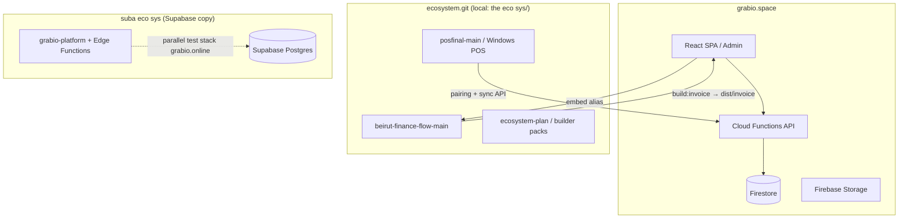

# Architecture — Overview

**Last updated:** 2026-07-09

## System diagram (current state)

## Per-repo summary

| Repo | [[Architecture/grabio.space|grabio.space]] | [[Architecture/ecosystem.git|ecosystem.git]] | [[Architecture/suba-eco-sys|suba eco sys]] |
|------|-------------|----------------|--------------|
| **Purpose** | Production platform (hosting, rules, API, admin) | Module source trees (finance, POS, plans) | Firebase→Supabase experiment |
| **Deploy target** | Firebase prod | Build artifacts consumed by main app; POS installer to Storage | grabio.online test only |
| **In grabio.space git?** | Yes (this repo) | **No** — gitignored; clone separately | **No** — separate nested repo |
| **Status** | PR #1 open (`feat/ecosystem-modular-local`) | `feat/ecosystem-modular-local` @ `baeb01b` has full eco tree | Schema migrated; R2 keys pending |

## Integration touchpoints

See [[Architecture/Integration-Map]].

## Hard boundaries

See [[Architecture/Repo-Boundaries]] — violated once in PR #1 (fixed 2026-07-09).
