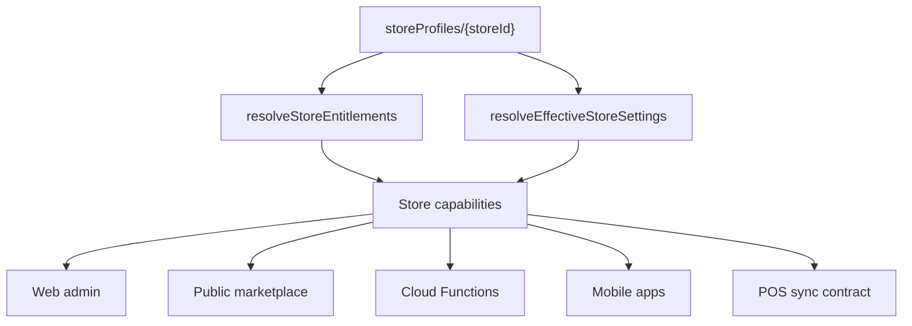

# Architecture - Packages, Workflows, Modules

**Last updated:** 2026-09-10

## Purpose

This is the canonical structure map for Grabio business types, packages, workflows, modules, and tenant options.

Future agents must update this page whenever a client request changes package behavior, business workflow behavior, tenant settings, setup flows, POS behavior, mobile behavior, or module availability.

## Current Verdict

Grabio has the correct base, but the structure is not complete enough to scale safely without this map and a shared settings resolver.

## Product Pivot - 2026-09-15

Canonical pivot map: `~/Documents/grabio-platform-docs/Architecture/Fine-Dining-Platform-Map.md`.

Grabio's active product center is now fine-dining restaurant daily operations plus CRM.

Roadmap classification:

- **Active core:** restaurant / fine dining / live kitchen operations and CRM.
- **Optional restaurant maturity modules:** accounting, finance, inventory, recipes, costing, purchasing, payroll, multi-branch, warehouse, and executive reports.
- **Maintenance for active clients:** shop, manufacturing, existing builder clients, existing accounting/inventory clients.
- **Connected high-end client modules:** builder, template, SEO, and content stay inside Grabio as gated modules, not a separate platform.
- **Deferred / dropped active growth:** NGO, freelancer, mini shop, publisher, and broad custom vertical expansion.

Do not delete working code because of this pivot. Hide, gate, maintain, or de-prioritize non-core areas unless Anwar explicitly reopens them.

What is correct:

- Runtime workflows exist in code.
- Starting packages exist in code.
- Modules exist in code.
- Store-level configuration exists mainly on `storeProfiles/{storeId}`.
- Tenant options and UI-first setup are now documented as platform rules.

What is weak:

- The roadmap is mostly in TypeScript registries, not in one maintained architecture map.
- Marketing verticals, package presets, runtime workflows, and builder intents are separate taxonomies.
- Web, Functions, mobile, invoice app, and POS do not share one effective settings resolver.
- Some client behavior can still become hardcoded store logic.

## Source Files

Current code sources:

- `src/lib/moduleManifest.ts`
- `functions/src/lib/moduleManifest.ts`
- `src/lib/packagePresets.ts`
- `src/lib/pricingDisplay.ts`
- `src/lib/moduleDependencies.ts`
- `src/types/storeProfile.ts`
- `src/data/marketing/packageRegistry.ts`
- `src/data/marketing/content/*.ts`
- `grabio-mobile/src/lib/storeProfileSync.ts`
- `src/lib/orderStatusFlow.ts`
- `grabio-mobile/src/lib/orderStatusFlow.ts`
- `src/types/subaccount.ts`

Current doc sources:

- `README.md`
- `architecture.md`
- `decision-log.md`
- `~/Documents/grabio-platform-docs/Architecture/Overview.md`
- `~/Documents/grabio-platform-docs/Backlog/Open.md`
- `~/Documents/grabio-platform-docs/Decision-Log/2026-09-10-client-requests-tenant-options.md`

## Current Runtime Taxonomy

### Business Workflows

Runtime type: `BusinessWorkflow`

Values:

- `shop`
- `live_kitchen`
- `factory`
- `ngo`
- `freelancer`
- `custom`

Notes:

- `live_kitchen` / restaurant is now the active product center.
- `shop` and `factory` remain maintained for active clients.
- `ngo`, `freelancer`, and `custom` are deferred and should not receive new active roadmap work without explicit approval.
- Workflow exclusivity is still code-driven in `src/lib/moduleDependencies.ts`.

### Starting Packages

Runtime type: `StartingPackageKey`

Values:

- `pkg_invoice`
- `pkg_web_presence`
- `pkg_mini_shop`
- `pkg_business_backend`
- `pkg_shop`
- `pkg_live_kitchen`
- `pkg_factory_flow`
- `pkg_ngo`
- `pkg_freelancer`

### Marketing Verticals

Live Phase 1 marketing verticals:

- `shop`
- `cafe`
- `restaurant`
- `manufacturing`
- `ecommerce`

Phase 2 registry entries:

- `ngo`
- `freelancer`
- `publisher`
- `custom`

Status after 2026-09-15 pivot:

- Restaurant/fine dining becomes the active growth vertical.
- Shop, ecommerce, and manufacturing become maintained/support verticals for current clients.
- Cafe should be evaluated only if it belongs to fine-dining/restaurant operations; generic mini shop growth is deferred.
- NGO, freelancer, publisher, and broad custom are deferred.

## Canonical Mapping

| Client-facing vertical | Current marketing slug | Starting package | Runtime workflow | Default module direction | Current status | Notes |
|---|---|---|---|---|---|---|
| Invoice-only / freelancer billing | none / `freelancer` phase 2 | `pkg_invoice` or `pkg_freelancer` | `freelancer` | `invoicing`, `invoice_manager`, `admin_mobile` for invoice package | Live core, marketing incomplete | Needs clearer difference between invoice-only and freelancer operations. |
| Website presence | none | `pkg_web_presence` | `shop` | `marketplace`, `builder`, `blog_publisher`, `admin_mobile` | Live package | Workflow name is `shop`, but package is website-only. Needs explicit map to avoid confusion. |
| Mini shop / cafe | `cafe` | `pkg_mini_shop` | `shop` | `invoicing`, `marketplace`, `payments`, `stock`, `admin_mobile`; cafe marketing also expects POS and recipe behavior | Partially aligned | Cafe marketing promises recipe/POS behavior, but package preset is mini shop. Needs decision. |
| Business backend | none | `pkg_business_backend` | `shop` | `invoicing`, `analytics`, `payments`, `delivery`, `stock`, `admin_mobile` | Live package | No clear marketing vertical. Useful as internal/admin package. |
| Shop / retail / wholesale | `shop` | `pkg_shop` | `shop` | core modules plus `stock` | Live | Strongest general base. |
| E-commerce | `ecommerce` | `pkg_shop` | `shop` | `marketplace`, `builder`, `stock`, `payments`, `delivery`, `analytics` | Live marketing, shared runtime | Shares runtime with shop. Needs tenant options for online-first fulfillment. |
| Restaurant / live kitchen | `restaurant` | `pkg_live_kitchen` | `live_kitchen` | core modules plus `stock`, `restaurant`, `pos` | Live/beta | Correct base for recipes, kitchen, reservations, advance orders, and status workflow options. |
| Manufacturing | `manufacturing` | `pkg_factory_flow` | `factory` | core modules plus `stock`, `factory` | Live | Correct base for BOM and production. POS excluded by workflow rules today. |
| NGO | `ngo` phase 2 | `pkg_ngo` | `ngo` | `invoicing`, `invoice_manager` | Planned/limited | Needs service/program/donor model before strong launch. |
| Publisher | `publisher` phase 2 | none | none | likely `builder`, `blog_publisher`, `content_creator`, `seo_assistant` | Planned only | Missing runtime package and workflow decision. |
| Custom | `custom` phase 2 | none or manual | `custom` | manual module selection | Planned/manual | Needs stronger guardrails so custom does not become unmaintainable. |

## Current Structural Drift

These are the known drift points to fix before adding many more verticals:

1. Marketing verticals do not map one-to-one to runtime workflows.
2. Package presets do not fully match marketing promises, especially cafe.
3. `src/lib/moduleManifest.ts` and `functions/src/lib/moduleManifest.ts` are duplicated and manually kept in sync.
4. `src/lib/entitlements.ts` and `functions/src/lib/entitlements.ts` have similar but not identical logic.
5. Mobile reads only a narrow store profile subset in `grabio-mobile/src/lib/storeProfileSync.ts`.
6. Order-status behavior is duplicated in web and mobile, and NIPCO is still hardcoded in `orderStatusFlow`.
7. Sub-account permissions are role-template based, not tenant-configurable role packs.
8. Builder business intent uses `store`, `restaurant`, and `manufacturer`, which is another taxonomy beside workflows and packages.
9. Legacy tiers and modular v2 still coexist, increasing edge cases.

## Shared Effective Settings Direction

The target is a shared resolver used by all consuming surfaces:

The resolver should return:

- Package and module entitlements.
- Effective business workflow.
- Effective order settings.
- Effective payment settings.
- Effective reservation/advance-order settings.
- Effective role and permission settings.
- Effective inventory and stock settings.
- Setup progress and required setup tasks.

Short-term rule:

- Do not add new raw settings without defaults and docs.
- Do not add client-specific hardcoded store IDs for normal behavior.
- When code must read a setting in more than one surface, document every consuming surface.

Medium-term rule:

- Move toward one shared generated manifest or shared package for web, Functions, and mobile.
- Add a sync check so web and Functions manifests cannot drift.

## Setup Health Review

Backend setup is allowed only as a starting method.

Every setup outcome must have one of these statuses:

- **UI ready:** visible and editable in admin.
- **UI read-only:** visible in admin, but locked intentionally.
- **UI gap:** data exists but the admin cannot yet manage it.
- **Temporary backend-only:** owner-approved, with a backlog item for UI.

Known setup areas to audit:

- Products, product categories, product icons, and visual fields.
- Recipes, raw materials, costing, sale prices, and price multipliers.
- Restaurant reservations, scheduled orders, and advance ordering.
- Order status flow and customer/team-facing status labels.
- Payment gateway availability across checkout, card/cart page, app, and POS.
- Sub-account roles, sales manager/team permissions, and mobile sync.
- Inventory mode, low-stock alerts, expiry alerts, and project-based inventory.
- Storefront mode, builder wizard progress, and demo/import setup.

## Future Change Gate

Before adding a new business type, package, module, or tenant option, future agents must answer:

1. Which client-facing vertical is this?
2. Which `StartingPackageKey` starts it?
3. Which `BusinessWorkflow` powers it?
4. Which modules are default-on?
5. Which modules are optional?
6. Which tenant settings control behavior?
7. What are the defaults for existing stores?
8. Which surfaces consume it: web, marketplace, Functions, mobile, POS, invoice app?
9. Where is the setup UI?
10. If setup is script/import/AI-driven, where does the user see, approve, and edit the result?
11. What docs were updated?
12. What verification proves the surfaces agree?

If those answers are not clear, stop and update this map before implementation.

## ERP Maturity / Odoo Gap

An external market/technical discussion compared mature ERP architecture to Odoo. That input is not source of truth for Grabio code, but it is useful as a maturity checklist.

Grabio should not copy Odoo 1:1. The correct target is a lighter modular SaaS that keeps Grabio's speed, but adopts the structural ideas that prevent feature chaos.

### Maturity Comparison

| ERP capability | Grabio current state | Gap to close |
|---|---|---|
| Modular app registry | `enabledModules`, `PACKAGE_PRESETS`, and `MODULE_CATALOG` exist | No full install/update/disable lifecycle with module versions, dependency migrations, and rollback rules |
| Unified data core | Firestore is the central operational store; `storeProfiles` carries tenant config | No single domain/data contract or ORM-like service layer shared by web, Functions, mobile, invoice app, and POS |
| Multi-company and multi-warehouse | Multi-store tenancy exists; store-scoped data exists | Legal entities, branches, warehouses, and inter-company permissions need a clearer model |
| Double-entry inventory and accounting | Accounting GL exists; production/inventory movements exist in parts | Stock movements are not yet a full valuation ledger automatically tied to GL entries for every receipt, delivery, transfer, and adjustment |
| Extensible action hooks and workflows | Cloud Functions triggers exist for orders, CRM sync, notifications, recipes, announcements, and other events | No formal workflow hook registry where modules can subscribe to domain events with documented inputs, retries, permissions, and audit trail |

### Lessons To Keep

1. Modules must behave like installable apps, not just hidden navigation flags.
2. Every module must speak the same store/customer/product/order/accounting data language.
3. Tenant settings must control behavior while package gates control access.
4. Inventory must mature into a stock movement ledger before advanced warehouses or manufacturing scale.
5. Accounting and inventory valuation should converge, not remain separate reporting worlds.
6. Automations need an explicit event/hook model, not isolated trigger code.
7. Multi-company and multi-warehouse should be planned before large clients force emergency patches.

### ERP Maturity Priorities

Do these in order:

1. Lock the package/workflow/module map before adding more verticals.
2. Define `resolveEffectiveStoreSettings` and make all surfaces consume it.
3. Create a module lifecycle model: installed, enabled, disabled, version, migratedAt, dependencies.
4. Define tenant hierarchy: owner account, store, branch, warehouse, legal entity, sub-account role.
5. Define stock movement ledger events: receipt, sale, return, transfer, adjustment, production consume, production output.
6. Define accounting valuation hooks for stock movements where accounting mode/package requires it.
7. Define domain event hooks for automations: order created, payment received, stock low, recipe consumed, customer updated, invoice overdue.

## Immediate Priorities

1. Update product, UI, and security structure around fine-dining restaurant operations plus CRM.
2. Decide whether `live_kitchen` becomes the main fine-dining workflow or whether a clearer fine-dining workflow layer is needed above it.
3. Define restaurant maturity stages: daily operations first, inventory/costing second, finance/accounting later.
4. Define restaurant-native roles and environment scopes before adding new UI.
5. Keep builder/template/SEO connected as gated high-end client modules.
6. Replace hardcoded restaurant behavior with tenant-configurable settings.
7. Define `resolveEffectiveStoreSettings` and document every consumer.
8. Expand mobile store profile sync to include restaurant tenant options required by mobile behavior.
9. Add UI visibility for backend/import/AI setup so restaurant users can continue setup from admin.
10. Add a manifest sync check between web and Functions.
